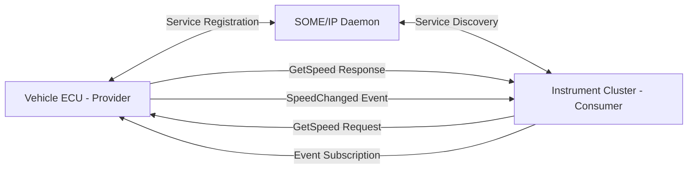

# Virtual Vehicle Speed Service Using SOME/IP and Python

## 1. Project Overview

This project demonstrates automotive communication using SOME/IP (Scalable service-Oriented Middleware over IP) with Python and the someipy library.

A simulated Vehicle ECU acts as the SOME/IP Service Provider, while an Instrument Cluster ECU acts as the Service Consumer.

The project implements service discovery, request-response communication, and event-based communication to exchange vehicle speed information.

### Objectives
- Understand SOME/IP architecture.
- Implement service discovery.
- Implement request-response communication.
- Implement event-based communication.
- Understand event group subscription.
- Analyze automotive network communication.

## 2. System Architecture



Both ECUs are simulated on the same computer using the loopback network interface.

## 3. Communication Parameters

| Parameter | Value |
|---|---|
| Service Name | VehicleSpeedService |
| Service ID | 0x1234 |
| Instance ID | 0x5678 |
| Major Version | 1 |
| Transport Protocol | UDP |
| Provider IP | 127.0.0.1 |
| Provider Port | 3000 |
| Consumer IP | 127.0.0.1 |
| Consumer Port | 3002 |
| SD Multicast Address | 224.224.224.245 |
| SD Port | 30490 |

## 4. SOME/IP Methods and Events

| Type | Name | ID | Description |
|---|---|---|---|
| Method | GetSpeed | 0x0001 | Requests current vehicle speed |
| Event | SpeedChanged | 0x8001 | Publishes updated vehicle speed |
| Event Group | Speed Event Group | 0x0001 | Groups speed notifications |

### Data Format

Vehicle speed is represented using an unsigned 16-bit integer (Uint16), measured in km/h.

### GetSpeed Method

1. Instrument Cluster sends a GetSpeed request.
2. Vehicle ECU receives the request.
3. Vehicle ECU reads the current simulated speed.
4. Vehicle ECU sends the speed response.

### SpeedChanged Event

1. Instrument Cluster discovers the service.
2. Instrument Cluster subscribes to the event group.
3. Vehicle ECU periodically publishes speed updates.
4. Instrument Cluster receives the notifications.

## 5. Project Structure

someip-python-assignment/
├── src/
│   ├── vehicle_speed_interface.py
│   ├── vehicle_speed_service.py
│   └── cluster_client.py
├── config/
│   └── someipyd.json
├── captures/
│   └── vehicle_speed_someip.pcapng
├── images/
├── README.md
└── .gitignore

## 6. Technologies Used

- Python 3
- SOME/IP
- someipy
- Ubuntu 22.04 (WSL)
- UDP
- Wireshark
- Git and GitHub

## 7. Installation and Setup

### Step 1: Clone the Repository

```bash
git clone <YOUR_GITHUB_REPOSITORY_URL>
cd someip-python-assignment
```

### Step 2: Create Virtual Environment

```bash
python3 -m venv .venv
source .venv/bin/activate
```

### Step 3: Install Dependency

```bash
python -m pip install someipy==2.1.2
```

## 8. Running the Project

Open three separate Ubuntu terminals.

### Terminal 1: Start SOME/IP Daemon

```bash
cd ~/someip-python-assignment
source .venv/bin/activate
someipyd --config config/someipyd.json
```

### Terminal 2: Start Vehicle ECU Provider

```bash
cd ~/someip-python-assignment
source .venv/bin/activate
python -m src.vehicle_speed_service
```

The Vehicle ECU:
- Connects to the SOME/IP daemon.
- Offers VehicleSpeedService.
- Handles GetSpeed requests.
- Publishes SpeedChanged events periodically.
- Simulates changing vehicle speed.

### Terminal 3: Start Instrument Cluster Consumer

```bash
cd ~/someip-python-assignment
source .venv/bin/activate
python -m src.cluster_client
```

The Instrument Cluster:
- Discovers VehicleSpeedService.
- Subscribes to the speed event group.
- Sends GetSpeed requests.
- Receives speed responses.
- Displays periodic speed notifications.

Press Ctrl+C to stop the applications.


## 9. Testing and Verification

The following tests were successfully performed:

| Test | Result |
|---|---|
| SOME/IP daemon startup | Successful |
| Provider connection and service offering | Successful |
| Consumer service discovery | Successful |
| Event group subscription | Successful |
| GetSpeed request-response | Successful |
| SpeedChanged event reception | Successful |
| Speed payload serialization and decoding | Successful |

Wireshark Analysis
The capture file is available at:

captures/vehicle_speed_someip.pcapng

The capture contains SOME/IP service discovery messages and GetSpeed request-response packets.

SpeedChanged events were verified through the consumer application logs. They were delivered through the SOME/IP daemon's internal communication path and were not visible as UDP notification packets in this loopback capture.
Python Syntax Verification
Run:
python -m py_compile \
src/vehicle_speed_interface.py \
src/vehicle_speed_service.py \
src/cluster_client.py

### Observed Event Output

The Instrument Cluster successfully received changing vehicle speed values:

```text
[CLUSTER] SpeedChanged event received: 40 km/h
[CLUSTER] SpeedChanged event received: 45 km/h
```
## 10. Limitations

- Both ECUs are simulated on one computer.
- Communication uses the loopback network interface.
- Vehicle speed is simulated.
- No physical automotive ECU or vehicle sensor is connected.

## 11. Future Improvements

- Communication between separate computers.
- Integration with real vehicle speed sensors.
- Addition of temperature and engine status services.
- SOME/IP packet analysis using Wireshark.
- Implementation of additional automotive services.

## 12. Learning Outcomes

- Understanding SOME/IP service-oriented architecture.
- Implementing service discovery.
- Understanding request-response communication.
- Implementing event-based communication. 
- Developing Python-based ECU simulations.
- Learning automotive network debugging.

  
